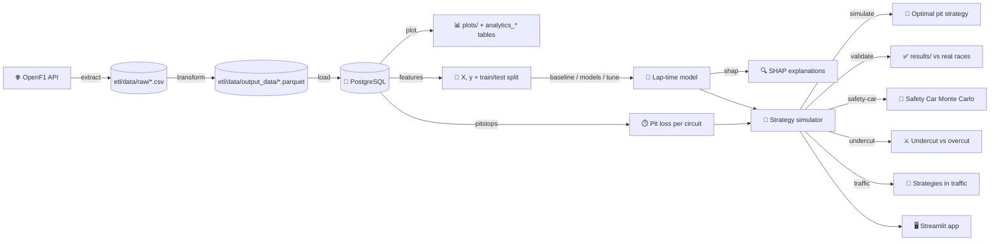
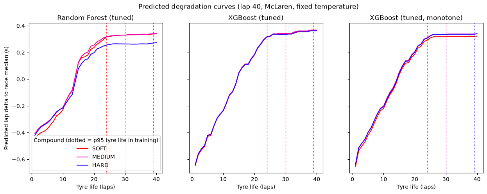
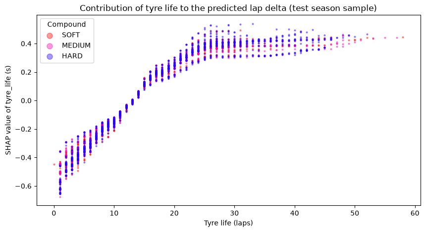
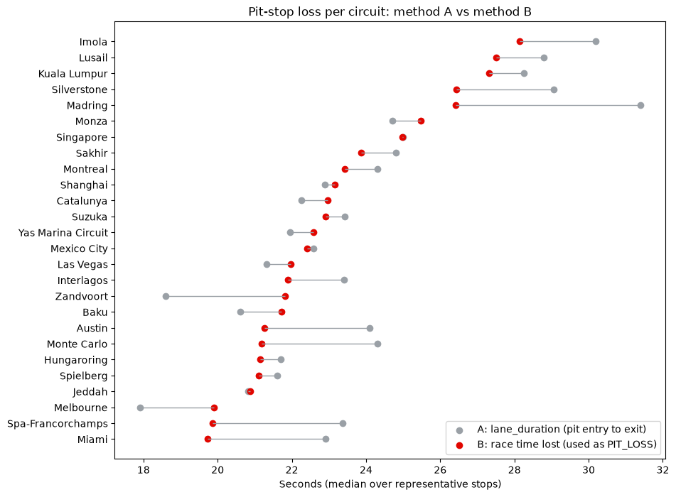
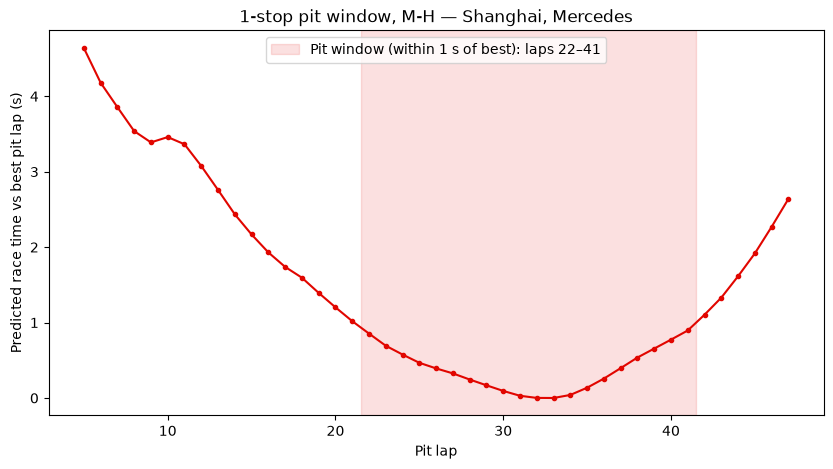
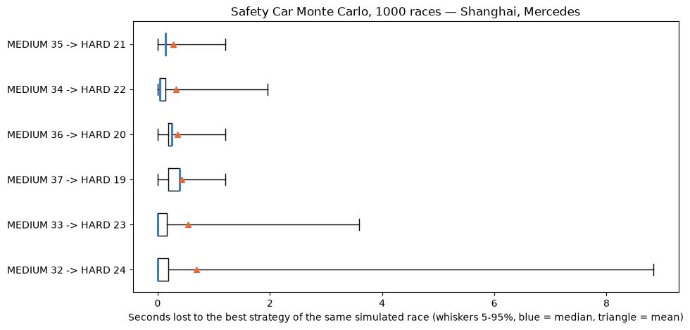
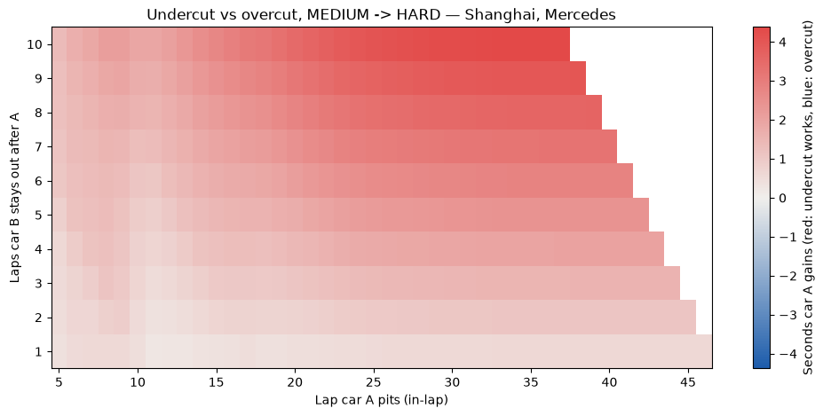
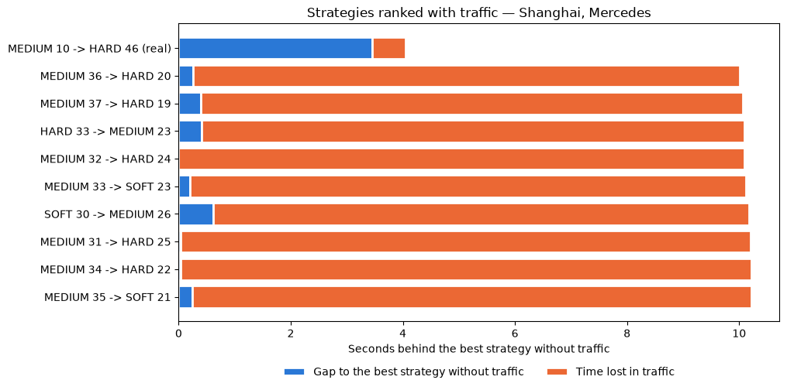

<div align="center">

# 🏎️ Predictive Race Strategy

**Predict Formula 1 lap times with machine learning, then simulate pit-stop windows to find the fastest race strategy.**

[](https://www.python.org/)
[](https://pola.rs/)
[](https://xgboost.ai/)
[](https://www.postgresql.org/)
[](https://openf1.org)

</div>

---

## 📖 Overview

Every F1 race strategy comes down to one equation:

```
Race time = Σ (predicted lap time for every lap) + (number of pit stops × pit loss)
```

This project tackles it in two parts:

1. **🧠 Machine learning** — train a model (XGBoost / Random Forest) that answers:
   *"How fast is lap N, on compound C, with tyres T laps old?"*
2. **🔁 Simulation** — loop over candidate strategies (one-stop, two-stop, different compounds and pit laps),
   ask the model for every lap, add the pit losses, and pick the strategy with the lowest total time.

OpenF1 doesn't provide a ready-made table with tyre compound and tyre age on every lap, so a big part of
the project is a **data engineering pipeline** that builds that table from several API endpoints.

---

## 🏗️ Architecture



### Extract

Downloads every non-cancelled race from the **2024, 2025 and 2026** seasons from [OpenF1](https://openf1.org) (free, no API key) as CSV.
Requests that hit the API rate limit (HTTP 429) are retried with backoff, honouring the `Retry-After` header.

| Endpoint | What it gives |
|---|---|
| `/sessions` | race list and `session_key` |
| `/drivers` | driver ↔ team mapping |
| `/laps` | one row per driver per lap |
| `/stints` | tyre compound and age per stint |
| `/pit` | pit stops and durations |
| `/weather` | track/air temperature, rainfall, wind |
| `/race_control` | flags, Safety Car and VSC messages |

### Transform

Builds a single, model-ready lap table with **Polars**:

- 🔗 **Range join** laps ↔ stints (`lap_start ≤ lap_number ≤ lap_end`) to attach compound per lap
- 🌡️ **As-of join** each lap to the latest weather reading
- 🛞 **Tyre life** = tyre age at stint start + laps completed in the stint
- 🚩 **Flags** for out-laps, in-laps, missing times, Safety Car and VSC laps
- 🧹 **Cleaning** — removes lap 1, pit laps, SC/VSC laps, wet/intermediate tyres, rain, and outliers slower than **107%** of each driver's median

Two more tables are built from the laps *before* cleaning, because they need the in-laps, out-laps and SC laps that cleaning removes:

- ⏱️ **`pit_stops`** — one row per stop with both pit-loss estimates (see [Pit loss](#pit-loss)) and an `is_representative` flag
  (green flag, dry, `stop_duration` ≤ 5 s, at least 2 clean reference laps)
- 🏁 **`results`** — finishing position and race time per driver, plus Safety Car / VSC laps, rain and a `suspended` flag
  for races with a stoppage (a gap of more than 300 s between two laps for most of the field — OpenF1 doesn't always send a `RED FLAG` message)
- 🚨 **`safety_car_periods`** — one row per SC or VSC deployment, from the lap it was deployed to the lap of the next Safety Car message
- 🚗 **`race_laps`** — every lap of every driver with its start time, so the gap between cars on track can be measured lap by lap

### Load

Writes the `laps`, `stints`, `pit_stops`, `results`, `safety_car_periods` and `race_laps` tables to PostgreSQL. Reloads are **idempotent**: rows for the sessions being loaded are deleted before appending.

### Analytics

Saves the EDA plots to `plots/` (lap time vs tyre life, lap time per driver, stint length per compound, average lap per team)
and stores their numbers as a new run in the `analytics_*` tables, tagged with an optional `--label` and the current git commit.
The tables are created from `ml/scripts/*.sql` on first use.

### Features

Turns the `laps` table into model inputs (`ml/features.py`):

| Feature | Encoding |
|---|---|
| `tyre_life` | numeric — tyre degradation |
| `compound` | ordinal: SOFT=0, MEDIUM=1, HARD=2 |
| `lap_number` | numeric — proxy for fuel load |
| `track_temperature` | numeric |
| `team_name` | one-hot; renamed teams are merged (`Kick Sauber` → `Audi`, `RB` → `Racing Bulls`) |
| `year` | numeric |
| `circuit_lap_time` | numeric — median lap of the circuit in the training seasons, a proxy for track length (see [Circuit features](#circuit-features)) |

The target is **`lap_delta`**: the fuel-corrected lap time minus that driver's median fuel-corrected lap in that race (seconds).
The fuel correction removes **0.05 s per lap of fuel still on board** (estimated on 2024–2025 with race × driver fixed effects),
so fuel burn no longer hides tyre degradation within a stint.
The feature column order is saved to `ml/columns/feature_columns.json` and the circuit values to `ml/columns/circuit_features.csv`,
so the simulator can build rows with exactly the same columns and values.

> **Why a delta and not the raw lap time?** Most of the variation in raw lap time comes from the circuit
> (~75 s in Monaco vs ~105 s in Spa) and from the season (2026 cars are ~2.3 s slower on average), and none of the
> original features could tell circuits apart. Predicting the absolute `lap_duration`, both models did **worse** than predicting
> the mean (MAE 10.8 s vs 9.9 s). Subtracting the race median cancels circuit and season pace, so the model only has to learn
> what changes *within* a race — tyre wear, compound, fuel and team. That is all the simulator needs: when
> strategies for the same race are compared, the race median is the same for all of them and cancels out.
> The trade-off: the model answers *"how much does this strategy gain or lose?"*, not *"how long is the race?"*.

Train/test is split **by season** (default: train on 2024–2025, test on 2026), so laps from the same race never land on both sides.
A random split would leak near-identical consecutive laps into the test set and inflate the score.

### Models

Every model is evaluated on the same test season (2026) with **MAE** and **RMSE**, in seconds of `lap_delta`:

| Model | File | MAE | RMSE |
|---|---|---|---|
| Baseline A: training mean for every lap | `ml/baseline.py` | 0.723 | 1.053 |
| Baseline B: training mean per compound | `ml/baseline.py` | 0.720 | 1.052 |
| Random Forest (defaults) | `ml/models.py` | 0.769 | 1.175 |
| XGBoost (defaults) | `ml/models.py` | 0.848 | 1.294 |
| Random Forest (tuned) | `ml/tuning.py` | 0.653 | 0.978 |
| XGBoost (tuned) | `ml/tuning.py` | 0.650 | 0.976 |
| **XGBoost (tuned, monotone)** — used by the simulator | `ml/tuning.py` | **0.653** | **0.980** |

With default hyperparameters both models **overfit and lose to the baselines** — even more since `circuit_lap_time` lets
deep trees memorise circuits. Tuned, they beat the best baseline by **0.067 s per lap (~9%)**. The baselines are computed
from the training seasons only, so they are an honest reference that every model must beat.

**Tuning** (`--tune`) runs a `RandomizedSearchCV` with `GroupKFold` grouped by race, so a race never lands in both a training
and a validation fold — the same leakage reasoning as the season split. The winners are shallow, regularised models
(XGBoost: depth 3, learning rate 0.03, 200 trees, row and column subsampling 0.7; Random Forest: depth 10,
`min_samples_leaf` 50, `max_features` sqrt).
The **monotone** XGBoost adds `monotone_constraints` so the predicted lap time can only go up as `tyre_life` grows — same
accuracy, but physically sensible curves for the simulator.

| Plot | What it shows |
|---|---|
| `predicted_vs_actual.png` | A cloud around the diagonal: predictions stay within about ±2.5 s while actual deltas go to ±5 s — the direction is right but the model is conservative at the extremes |
| `residuals_vs_tyre_life.png` | Residuals are centred on zero with no trend over tyre life. The largest errors (up to +9 s) are slower-than-predicted laps on fresh tyres, likely traffic or race events the features can't see |
| `feature_importance.png` | Which features the tuned models split on |
| `degradation_curves.png` | Predicted `lap_delta` for tyre life 1–40 on each compound, with team, lap and temperature fixed |



The curves rise by about **1 s over the first ~25 laps** and then go flat. Two things stand out: the three compounds
are **almost on top of each other**, and beyond ~25 laps there is too little data for the trees to learn anything, so they
predict a flat line (they can't extrapolate). Both shape the strategies the simulator picks — see Limitations below.

### Circuit features

The guide's *multiple circuits* extension: two circuit descriptors, computed from the **training seasons only** so the test
season can't leak in (`MLfeatures.circuit_features`):

| Feature | How | Test MAE (fixed XGBoost) |
|---|---|---|
| none | — | 0.709 |
| `circuit_lap_time` — track length | median lap at the circuit (Spielberg 70.9 s … Spa 108.2 s) | **0.706** |
| `circuit_deg` — abrasiveness, per compound | slope of fuel-corrected lap time vs tyre life within each stint, shrunk towards the compound's average when a circuit has few laps | 0.728 |

Only `circuit_lap_time` is kept. The degradation slopes measured on 2024–2025 make 2026 **worse**: the 2026 cars and
tyres degrade differently, so a feature that is precise for the past misleads on the new season. `circuit_deg` is still
saved in `circuit_features.csv` for reference. Circuits raced only in the test season (Madring) take their lap time from
that race.

### Explaining the model (SHAP)

`--shap` computes exact SHAP values of the monotone XGBoost on 5,000 test laps (`ml/explain.py`): every prediction is split
into one contribution per feature, which add back up to the prediction (checked to 1e-6 s).

| Feature | Mean \|SHAP\| (s per lap) |
|---|---|
| `tyre_life` | 0.262 |
| `lap_number` | 0.094 |
| `circuit_lap_time` | 0.067 |
| `track_temperature` | 0.047 |
| `year` | 0.011 |
| `compound` | **0.009** |
| each team | < 0.001 |



This puts a number on the main limitation: **the compound moves a lap by 0.009 s on average, 30× less than tyre age**, and
the tyre-life contribution (above) is the same curve for SOFT, MEDIUM and HARD. Hotter track → faster lap relative to the
driver's median, and the team barely matters because the target already removes each driver's own pace.
`plots/shap_summary.png` has the full beeswarm.

### Pit loss

A pit stop costs more than the time spent stationary. `--pitstops` compares two ways of measuring it, per circuit:

| Method | What it measures |
|---|---|
| **A** — OpenF1 `lane_duration` | pit entry line to pit exit line. `pit_duration` is the same number (identical in all 2,338 stops), and `stop_duration` is only the stationary time (median 2.6 s, missing for 57% of stops) |
| **B** — in-lap + out-lap − 2 × reference lap | the race time the stop actually cost. The reference is the median of up to 3 clean laps on each side of the stop, so old and new tyres balance out |



**B is what the simulator uses** (`PIT_LOSS`), because it is measured in the same unit as the race-time equation. Medians over
1,461 representative stops: **A 23.4 s, B 22.5 s**, from ~20 s (Miami, Spa, Melbourne) to ~28 s (Lusail, Imola).
A and B differ in both directions: A leaves out the braking into and accelerating out of the pit lane and the cold tyres on
the out-lap, but it also counts the pit-lane distance as if the car would otherwise have covered it in zero time.
At Monaco, Austin, Spa and Miami A is ~3 s higher; at Zandvoort and Melbourne B is 2–3 s higher.

### Strategy simulation

`ml/simulate.py` turns the lap-time model back into a race time:

```
lap time   = base pace + predicted lap_delta + 0.05 s × laps of fuel left
race time  = Σ lap time + (number of stops × PIT_LOSS of the circuit)
```

`base pace` is the same for every strategy of a car, so it doesn't change which strategy wins; it is only needed to compare
with a real race time. A strategy is a list of stints, e.g. `MEDIUM 18 -> HARD 39`. `tyre_life` restarts at 0 on every
stint (the same convention as the ETL), and rows are built with exactly the encoding and column order of training.

`--simulate` searches every **1- and 2-stop strategy**: every pit lap × every compound order, keeping only those that
use **two different dry compounds**, have **no stint shorter than 5 laps**, and **no stint longer than the 99th percentile
of tyre life seen in training** for that compound (SOFT 30, MEDIUM 47, HARD 56 laps), so the optimiser can't exploit the
flat line the trees predict beyond their data. All ~15–25 thousand strategies go through the model in **one** `predict`
call (~5 s per race).

Example — Shanghai, Mercedes (56 laps, pit loss 23.2 s):

| Strategy | Stops | Gap to best |
|---|---|---|
| **MEDIUM 33 → HARD 23** | 1 | **0.00 s** |
| MEDIUM 32 → HARD 24 | 1 | +0.00 s |
| MEDIUM 34 → SOFT 22 (best other compounds) | 1 | +0.19 s |
| best 2-stop | 2 | +17.71 s |



The U-shaped curve has its minimum at lap 33, but the bottom is wide: every pit lap from 22 to 41 is within 1 s.
The pattern is the same on every circuit tried — **one stop wins by 4–18 s** (Spielberg +4.3 s, Monza +16.3 s,
Shanghai +17.7 s, Silverstone +18.4 s for the best 2-stop), because the model's degradation is too mild to pay for a second
21–26 s stop.

### Validation

`--validate` runs the simulator on the **real strategies of the top 5 finishers of every 2026 race** (the test season,
never seen in training) and compares them with their real race times. Race time is measured from the start of lap 2 to
the start of the last lap, because OpenF1 often has no `lap_duration` for lap 1 or the last lap; the prediction sums
exactly the same laps. Base pace is each driver's median clean, fuel-corrected lap in that race.

Races are grouped by their worst event, because the simulator models none of them:

| Group | Races | Drivers | Race time MAE | Bias | Gap MAE | Spearman |
|---|---|---|---|---|---|---|
| **VSC only** | 6 | 28 | 70.4 s (1.3%) | −70.4 s | **4.5 s** | **0.83** |
| Safety Car | 6 | 26 | 255.7 s (4.8%) | −255.7 s | 8.9 s | 0.68 |
| Wet | 2 | 5 | 235.0 s (4.1%) | −235.0 s | 8.4 s | 0.80 |
| Suspended | 3 | 15 | 2,156.1 s (29.1%) | −2,156.1 s | 18.5 s | 0.70 |

- **Bias is always negative**: the simulator only knows green-flag laps, so every (much slower) neutralised lap or
  stoppage is time it never adds. The error grows with the number of neutralised laps — −27 s in Hungary (2 VSC laps),
  −120 s in Melbourne (7), ~−2,000 s where the race was stopped for half an hour.
- **Gap MAE** compares each driver to the average of the top 5 in the same race, so whatever every car lived through
  cancels out. In VSC-only races the simulator gets the **gaps between the top finishers right to ~4.5 s over a whole race**,
  and ranks them well (Spearman 0.83).
- **Optimal vs winner** (`results/validation_optimal.csv`): the optimal strategy matched the winner's number of stops in
  6/14 races and their compounds in 1/14 (Shanghai). Of the 6 one-stop winners, 3 pitted inside the simulator's ±1 s window
  for the compounds they chose, and the simulator rates every one-stop winner's strategy within 0.1–5.7 s of its optimum.
  Winners used 2–4 stops in the other 8 races, where the simulator claims a median gain of 24 s from stopping once —
  a sign of the model's missing degradation (and of Safety Cars it doesn't model), not of 8 wrong race strategies.

> **Conclusion.** On a green-flag race the simulator predicts the gaps between top finishers to about 4 s over 50–70 laps
> and ranks them well, so the lap-time model and pit-loss estimate are sound. As a strategy optimiser it is weaker: it
> can't tell compounds apart and sees too little degradation, so it always picks one stop with stints as long as the
> limits allow — while the real winners often stopped twice, partly to react to Safety Cars it doesn't model.

### Safety Car Monte Carlo

`--safety-car` (`ml/safety_car.py`) runs the best strategies through **1,000 random races** with Safety Cars and VSCs:

- **How many**: Poisson with the circuit's deployments per race, shrunk towards the all-circuit average (3 races of prior),
  because 1–3 races per circuit are too few on their own. Suspended races are left out — a red flag is not a Safety Car.
- **When and how long**: a real deployment drawn at random, scaled to the race distance, so lap-1 incidents keep their weight.
- **What a neutralised stop costs**, measured from the data: in-lap + out-lap minus the field's laps on the same two laps.
  **SC: 14.3 s, 62% of the green-flag loss** (284 stops); **VSC: 13.6 s, 60%** (47 stops).
- **Reaction**: when a neutralisation starts, the car brings its next stop forward to that lap if the current stint has at
  least 5 laps and the next one still fits its compound's limit.

Every strategy goes through the *same* random races, so differences come from the strategy, not luckier draws. To make 47
strategies × 1,000 races fast, the model predicts a grid of every compound × tyre life × lap once; a race is then a sum of
lookups (checked against the simulator to 0.0000 s).

Shanghai, Mercedes (1.16 SC + 0.16 VSC expected per race, 72% of races neutralised at least once):

| Strategy | Green-flag gap | Expected gap | Mean regret | 90th pct regret | Best in |
|---|---|---|---|---|---|
| **MEDIUM 35 → HARD 21** | +0.14 s | **0.00 s** | 0.28 s | 0.23 s | 1.4% |
| MEDIUM 34 → HARD 22 | +0.04 s | +0.06 s | 0.33 s | 0.24 s | 2.0% |
| MEDIUM 33 → HARD 23 (green-flag best) | 0.00 s | +0.26 s | 0.54 s | 0.60 s | 58.2% |
| MEDIUM 30 → HARD 26 | +0.09 s | +0.69 s | 0.97 s | 3.21 s | 2.7% |



*Regret* is what a strategy loses against the best candidate for that same random race. Planning to stop **a couple of laps
later** is better on average with Safety Cars: it leaves more laps in which a neutralisation can arrive before the stop
and make it cheap. The green-flag best is the most often *the* best (it wins every race without a Safety Car), but it is
the riskier choice. The differences are small (< 1 s) because the model's flat degradation leaves little to gain from
moving a stop; laps behind the Safety Car are equally slow for every strategy, so they are left out.

### Undercut vs overcut

`--undercut` (`ml/undercut.py`) simulates two identical cars on the same compounds: car A pits first, car B stays out
1–10 laps longer. The race before A's stop and the pit loss are the same for both and cancel; what's left is B's old tyres
against A's new ones until B is back out.



Shanghai, MEDIUM → HARD: pitting **one lap earlier gains 0.56 s** (median over pit laps, 0.23–0.61 s), and 0.3–0.4 s more
for each extra lap B waits. So the undercut works from up to ~0.6 s behind. **The overcut never pays off** in the model:
with monotone degradation the new tyre is always faster, and the things that make overcuts work — cold tyres on the
out-lap, traffic on rejoining, a degradation cliff on the new compound — aren't in the lap-time model.

### Traffic

`--traffic` (`ml/traffic.py`) re-ranks the best strategies racing a real field:

- **Dirty air, estimated from data.** For every lap, the gap to the car that crossed the line just before (from `race_laps`)
  is compared with the model's residual on that lap. Using the residual matters: fast cars catch slow ones, so raw lap times
  next to another car would mix traffic with pace.

  | Gap to the car ahead | < 0.5 s | 0.5–1.0 s | 1.0–1.5 s | 1.5–2.0 s | 2.0–3.0 s |
  |---|---|---|---|---|---|
  | Seconds lost per lap | 0.42 | 0.17 | 0.10 | 0.07 | 0.03 |

- **The field** is every car on the lead lap of the latest race at the circuit, each on its **real strategy and own base
  pace** through the model, starting from the real order after lap 1. Our car replaces the team's best finisher.
- **Overtaking**: close behind a car, ours loses the dirty-air penalty and gets past only if its free lap is **0.7 s faster**
  (an assumption: OpenF1 laps don't say who overtook whom); otherwise it crosses the line 0.3 s behind. Rivals don't react
  to us and lapped cars are ignored.

Shanghai 2026, Mercedes in place of Antonelli (8 cars on the lead lap, all of whom stopped on lap 9 or 10, one also on lap 1):

| Strategy | Without traffic | Lost in traffic | Laps held up | Rank with traffic |
|---|---|---|---|---|
| **MEDIUM 10 → HARD 46 (real)** | 24th | 0.6 s | 2 | **1st, P1** |
| MEDIUM 36 → HARD 20 | 13th | 9.8 s | 22 | 2nd, P2 |
| MEDIUM 33 → HARD 23 (green-flag best) | 1st | 10.3 s | 25 | 14th, P2 |



With traffic, **the strategy Antonelli actually used beats every "optimal" one by 6 s**. Stopping late means rejoining
behind cars that are already on new tyres and can't be passed without a 0.7 s advantage, and ~25 laps in dirty air
cost ~10 s — far more than the ~3 s the late stop gains in free air. Caveat: the real lap-10 stops were made under a
Safety Car; here every car pays the full green-flag pit loss.

### Streamlit app

`streamlit run app.py` — pick a circuit and team (race distance, track temperature and pit loss are pre-filled from the
latest race there and can be changed) and get four tabs: the **best strategy** with its pit window, the **Safety Car**
Monte Carlo, the **undercut** table and the **traffic** ranking. It calls the same classes as the CLI.

### Results web page

`web/index.html` is a static page (plain HTML, CSS and JavaScript, no libraries) with every comparison above as an
interactive chart: hover for values, toggle series in the legends, pick a circuit for the strategy search, and open
"Show table" under any chart for the numbers. It follows the system light/dark theme, with a toggle.

`python main.py --web 1` (`ml/export_web.py`) writes everything it shows to `web/data.js` — model scores, the circuit-feature
experiment, SHAP values, degradation curves, pit loss, the best strategy at all 26 circuits, the validation tables, and the
Safety Car, undercut and traffic results for Shanghai. It is a script rather than JSON so the page also works opened
straight from disk, where browsers block `fetch()`. Re-run it after `--tune` or `--validate` to refresh the page.

---

## 📁 Project structure

```
predictive_race_strategy/
├── main.py               # CLI entry point, one flag per step
├── app.py                # Streamlit app: pick a race, see the recommended strategy
├── web/                  # static results page: index.html, style.css, app.js, data.js (from --web)
├── controller.py         # base classes + database engine
├── etl/
│   ├── controller.py     # ETLController: extract, transform, load
│   ├── db_setup.py       # creates the Postgres database
│   └── data/
│       ├── raw/          # CSVs as downloaded from OpenF1 (git-ignored)
│       └── output_data/  # laps, stints, pit_stops, results, safety_car_periods, race_laps (.parquet)
├── ml/
│   ├── controller.py     # MLController: database queries and EDA plots
│   ├── analytics.py      # aggregates behind the plots, saved to analytics_* tables
│   ├── features.py       # MLfeatures: fuel-corrected race delta target, circuit features, encoding, X/y, season split
│   ├── baseline.py       # MLbaseline: mean and mean-per-compound baselines, MAE/RMSE
│   ├── models.py         # MLModels: Random Forest and XGBoost, results table, evaluation plots
│   ├── tuning.py         # MLTuning: grouped-CV tuning, monotone XGBoost, importance and degradation plots
│   ├── pit_loss.py       # MLPitLoss: method A vs B per circuit, PIT_LOSS
│   ├── simulate.py       # MLSimulate: race-time simulator and strategy search
│   ├── validate.py       # MLValidate: real strategies vs real race times, optimal vs winner
│   ├── explain.py        # MLExplain: SHAP values of the monotone XGBoost
│   ├── safety_car.py     # MLSafetyCar: Safety Car / VSC Monte Carlo
│   ├── undercut.py       # MLUndercut: two cars, who gains by pitting first
│   ├── traffic.py        # MLTraffic: dirty air estimate and strategies against a real field
│   ├── export_web.py     # MLExportWeb: every result the web page shows, to web/data.js
│   ├── scripts/          # SQL for the analytics_* tables
│   ├── columns/          # feature_columns.json, circuit_features.csv
│   └── trained/          # saved models (git-ignored, rebuilt by --tune)
├── plots/                # EDA, model, SHAP, pit loss, pit window, Safety Car, undercut and traffic plots
├── results/              # validation tables (CSV)
├── docker/               # Dockerfile, docker-compose.yml, requirements.txt (pinned)
└── .env.example
```

---

## 🚀 Getting started

### 1. Clone and install

```bash
git clone https://github.com/anabbarbosa/predictive_race_strategy.git
cd predictive_race_strategy

python -m venv .venv
# Windows
.venv\Scripts\Activate.ps1
# macOS / Linux
source .venv/bin/activate

pip install -r docker/requirements.txt
```

### 2. Configure the database

Copy `.env.example` to `.env` in the project root and fill in the values, for example:

```env
PGUSER=postgres
PGPASSWORD=your-password
PGHOST=localhost
PGPORT=5432
PGDATABASE=race_strategy
```

Then create the database:

```bash
python etl/db_setup.py
```

### 3. Run the pipeline

Each step can be run on its own or chained together:

```bash
# Download raw data from OpenF1
python main.py --download 1

# Build the lap, stint, pit stop and result tables (etl/data/output_data/)
python main.py --process 1

# Load it into PostgreSQL
python main.py --merge 1

# Or everything at once
python main.py --download 1 --process 1 --merge 1

# Save the EDA plots and their results as a labelled analytics run
python main.py --plot 1 --label "baseline"

# Build the features and split train/test by season (test = 2026 by default)
python main.py --features 1
python main.py --features 1 --test-year 2025

# Evaluate the baselines only
python main.py --baseline 1

# Train Random Forest and XGBoost, print the results table and save the evaluation plots
python main.py --models 1

# Tune both models and save them to ml/trained/ — required before --simulate and --validate
python main.py --tune 1

# Pit loss per circuit, method A vs B (plots/pit_loss.png)
python main.py --pitstops 1

# Find the best strategy for a team at a circuit (plots/pit_window.png)
python main.py --simulate 1 --circuit Shanghai --team Mercedes

# Predict a single strategy, optionally as an absolute race time from one driver's base pace
python main.py --simulate 1 --circuit Shanghai --team Mercedes --strategy MEDIUM:10,HARD:46
python main.py --simulate 1 --circuit Shanghai --team Mercedes --strategy MEDIUM:10,HARD:46 --session-key 11245 --driver 12

# Compare with the real 2026 races (results/*.csv)
python main.py --validate 1

# Explain the model with SHAP values (plots/shap_*.png)
python main.py --shap 1

# Safety Car Monte Carlo, undercut and traffic for a team at a circuit
python main.py --safety-car 1 --circuit Shanghai --team Mercedes --n-sims 1000
python main.py --undercut 1 --circuit Shanghai --team Mercedes --compounds MEDIUM,HARD
python main.py --traffic 1 --circuit Shanghai --team Mercedes

# The same in a browser
streamlit run app.py

# Export the results for the static web page, then open web/index.html
python main.py --web 1

# From a fresh clone, everything at once
python main.py --download 1 --process 1 --merge 1 --tune 1 --pitstops 1 --validate 1
```

`--simulate` and `--safety-car` take the race distance, track temperature and pit loss from the latest race at the circuit;
override them with `--total-laps`, `--track-temp` and `--pit-loss`. `--traffic` races the field of that latest race.

> **Windows tip:** if printing the results table raises `UnicodeEncodeError`, run
> `$env:PYTHONIOENCODING="utf-8"` first.

> **Note:** the extract step writes into `etl/data/raw/<endpoint>/` — make sure the folders
> `sessions`, `drivers`, `laps`, `stints`, `pits`, `weather` and `race_control` exist first.

---

## 📊 Current dataset

| | |
|---|---|
| Seasons | 2024, 2025, 2026 |
| Races | 64 (23 + 24 + 17) |
| Clean laps | 58,403 (21,526 + 21,608 + 15,269) |
| Stints | 3,685 |
| Pit stops | 2,586 (1,461 representative) |
| Safety Car / VSC periods | 87 (65 SC, 22 VSC) in 46 races |
| Columns | 56 (timing, sectors, speed traps, tyres, weather, flags) |
| Train / test | 43,134 laps (2024–2025) / 15,269 laps (2026) |

---

## ⚠️ Limitations

- **Compounds look alike to the model.** Its SOFT, MEDIUM and HARD degradation curves almost overlap, so the optimal
  compound order is close to arbitrary (1/14 matches with the winners; SHAP puts the compound at 0.009 s per lap). Compound pace probably differs too little within
  a driver's race once the median is subtracted; per-circuit compound offsets would be a next step.
- **Degradation stops at ~23 laps of tyre life**, where the training data thins out. Longer stints look free, which pushes
  the optimiser to one stop and to the stint limits (p99 tyre life per compound).
- **Race events are separate add-ons.** `--simulate` and `--validate` are green-flag only; Safety Cars, undercuts and
  traffic each have their own simulation, and they aren't combined (no traffic in the Safety Car Monte Carlo, no Safety
  Car in the traffic race). Suspensions are not simulated.
- **Traffic is one-sided.** Rivals follow their predicted laps and don't react to our car, the 0.7 s overtaking threshold
  is an assumption, and lapped cars are left out.
- **New tyres only.** Every simulated stint starts at tyre life 0; real drivers often start on used tyres from qualifying.
- **Fixed pit loss per circuit**, the green-flag median, except in the Safety Car Monte Carlo (62% under SC, 60% under VSC).
- **No overcut.** Without cold out-laps or a degradation cliff on new tyres, pitting first always gains.
- **Base pace from the race itself** in the validation, so it measures strategy and degradation, not whether the model can
  predict a driver's pace before the race.
- **Dry races only.** Wet and intermediate tyres are removed from training.

---

## 🗺️ Roadmap

- [x] Extract race data from the OpenF1 API
- [x] Build and clean the lap-level feature table
- [x] Load into PostgreSQL
- [x] Exploratory analysis (plots + analytics tables)
- [x] Feature engineering (tyre life, compound, fuel load proxy, team, track temperature)
- [x] Train/test split by season
- [x] Baselines (global mean, mean per compound)
- [x] Train and evaluate lap-time models (XGBoost vs. Random Forest)
- [x] Race-relative target (`lap_delta`) so circuit and season pace cancel out
- [x] Tune hyperparameters with grouped cross-validation
- [x] Pit loss per circuit (lane time vs race time lost)
- [x] Strategy simulator over pit-stop windows and compound choices
- [x] Validate predicted vs. actual race strategies
- [x] Fuel-corrected lap times
- [x] Circuit features (track length kept; per-circuit degradation tested and rejected)
- [x] SHAP explanations
- [x] Safety Car Monte Carlo with cheaper neutralised stops
- [x] Undercut vs overcut between two cars
- [x] Traffic: dirty air and overtaking against a real field
- [x] Streamlit app
- [x] Static results web page with interactive charts
- [ ] Per-circuit compound offsets, so the model can tell compounds apart
- [ ] Start stints on used tyres
- [ ] Combine Safety Cars and traffic in one race simulation
- [ ] More features (track evolution, driver)

---

## 🛠️ Tech stack

**Python** · **Polars** · **PyArrow** · **scikit-learn** · **XGBoost** · **SHAP** · **SciPy** · **SQLAlchemy** · **psycopg** · **PostgreSQL** · **Click** · **Matplotlib** · **Streamlit** · **Jupyter**

---

## 🙏 Acknowledgements

- [OpenF1](https://openf1.org) for the free and open Formula 1 data API.