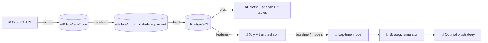

<div align="center">

# 🏎️ Predictive Race Strategy

**Predict Formula 1 lap times with machine learning, then simulate pit-stop windows to find the fastest race strategy.**

[](https://www.python.org/)
[](https://pola.rs/)
[](https://xgboost.ai/)
[](https://www.postgresql.org/)
[](https://openf1.org)

</div>

---

## 📖 Overview

Every F1 race strategy comes down to one equation:

```
Race time = Σ (predicted lap time for every lap) + (number of pit stops × pit loss)
```

This project tackles it in two parts:

1. **🧠 Machine learning** — train a model (XGBoost / Random Forest) that answers:
   *"How fast is lap N, on compound C, with tyres T laps old?"*
2. **🔁 Simulation** — loop over candidate strategies (one-stop, two-stop, different compounds and pit laps),
   ask the model for every lap, add the pit losses, and pick the strategy with the lowest total time.

OpenF1 doesn't provide a ready-made table with tyre compound and tyre age on every lap, so a big part of
the project is a **data engineering pipeline** that builds that table from several API endpoints.

---

## 🏗️ Architecture



### Extract

Downloads every non-cancelled race from the **2024, 2025 and 2026** seasons from [OpenF1](https://openf1.org) (free, no API key) as CSV.
Requests that hit the API rate limit (HTTP 429) are retried with backoff, honouring the `Retry-After` header.

| Endpoint | What it gives |
|---|---|
| `/sessions` | race list and `session_key` |
| `/drivers` | driver ↔ team mapping |
| `/laps` | one row per driver per lap |
| `/stints` | tyre compound and age per stint |
| `/pit` | pit stops and durations |
| `/weather` | track/air temperature, rainfall, wind |
| `/race_control` | flags, Safety Car and VSC messages |

### Transform

Builds a single, model-ready lap table with **Polars**:

- 🔗 **Range join** laps ↔ stints (`lap_start ≤ lap_number ≤ lap_end`) to attach compound per lap
- 🌡️ **As-of join** each lap to the latest weather reading
- 🛞 **Tyre life** = tyre age at stint start + laps completed in the stint
- 🚩 **Flags** for out-laps, in-laps, missing times, Safety Car and VSC laps
- 🧹 **Cleaning** — removes lap 1, pit laps, SC/VSC laps, wet/intermediate tyres, rain, and outliers slower than **107%** of each driver's median

### Load

Writes the clean `laps` and `stints` tables to PostgreSQL. Reloads are **idempotent**: rows for the sessions being loaded are deleted before appending.

### Analytics

Saves the EDA plots to `plots/` (lap time vs tyre life, lap time per driver, stint length per compound, average lap per team)
and stores their numbers as a new run in the `analytics_*` tables, tagged with an optional `--label` and the current git commit.
The tables are created from `ml/scripts/*.sql` on first use.

### Features

Turns the `laps` table into model inputs (`ml/features.py`):

| Feature | Encoding |
|---|---|
| `tyre_life` | numeric — tyre degradation |
| `compound` | ordinal: SOFT=0, MEDIUM=1, HARD=2 |
| `lap_number` | numeric — proxy for fuel load |
| `track_temperature` | numeric |
| `team_name` | one-hot; renamed teams are merged (`Kick Sauber` → `Audi`, `RB` → `Racing Bulls`) |
| `year` | numeric |

The target is **`lap_delta`**: the lap time minus the median lap time of that race (seconds).
The feature column order is saved to `ml/columns/feature_columns.json` so the simulator can build rows with exactly the same columns.

> **Why a delta and not the raw lap time?** Most of the variation in raw lap time comes from the circuit
> (~75 s in Monaco vs ~105 s in Spa) and from the season (2026 cars are ~2.3 s slower on average), and none of the
> features can tell circuits apart. Predicting the absolute `lap_duration`, both models did **worse** than predicting
> the mean (MAE 10.8 s vs 9.9 s). Subtracting the race median cancels circuit and season pace, so the model only has to learn
> what changes *within* a race — tyre wear, compound, fuel and team. That is all the simulator needs: when
> strategies for the same race are compared, the race median is the same for all of them and cancels out.
> The trade-off: the model answers *"how much does this strategy gain or lose?"*, not *"how long is the race?"*.

Train/test is split **by season** (default: train on 2024–2025, test on 2026), so laps from the same race never land on both sides.
A random split would leak near-identical consecutive laps into the test set and inflate the score.

### Models

Every model is evaluated on the same test season (2026) with **MAE** and **RMSE**, in seconds of `lap_delta`:

| Model | File | MAE | RMSE |
|---|---|---|---|
| Baseline A: training mean for every lap | `ml/baseline.py` | 1.32 | 1.75 |
| Baseline B: training mean per compound | `ml/baseline.py` | 1.30 | 1.73 |
| **Random Forest** (defaults) | `ml/models.py` | **1.06** | **1.47** |
| XGBoost (defaults) | `ml/models.py` | 1.10 | 1.52 |

The Random Forest is about **0.25 s per lap (~19%)** more accurate than the best baseline.
The baselines are computed from the training seasons only, so they are an honest reference that every model must beat.

`--models` also saves two evaluation plots to `plots/`:

| Plot | What it shows |
|---|---|
| `predicted_vs_actual.png` | Points follow the diagonal, but predictions stay within about ±3 s while actual deltas go to ±5 s — the model gets the direction right but is conservative at the extremes |
| `residuals_vs_tyre_life.png` | Residuals are centred on zero with no trend, so tyre degradation is captured. The large errors (+10 to +30 s) are always slower-than-predicted laps at low tyre life, likely race events (traffic, SC) the features can't see |

---

## 📁 Project structure

```
predictive_race_strategy/
├── main.py               # CLI entry point (download / process / merge / plot / features / baseline / models)
├── controller.py         # base classes + database engine
├── etl/
│   ├── controller.py     # ETLController: extract, transform, load
│   ├── db_setup.py       # creates the Postgres database
│   └── data/
│       ├── raw/          # CSVs as downloaded from OpenF1 (git-ignored)
│       └── output_data/  # laps.parquet, stints.parquet — clean tables
├── ml/
│   ├── controller.py     # MLController: database queries and EDA plots
│   ├── analytics.py      # aggregates behind the plots, saved to analytics_* tables
│   ├── features.py       # MLfeatures: race delta target, encoding, X/y, season split
│   ├── baseline.py       # MLbaseline: mean and mean-per-compound baselines, MAE/RMSE
│   ├── models.py         # MLModels: Random Forest and XGBoost, results table, evaluation plots
│   ├── scripts/          # SQL for the analytics_* tables
│   └── columns/          # feature_columns.json
├── plots/                # EDA and model evaluation plots
└── requirements.txt
```

---

## 🚀 Getting started

### 1. Clone and install

```bash
git clone https://github.com/<your-username>/predictive_race_strategy.git
cd predictive_race_strategy

python -m venv .venv
# Windows
.venv\Scripts\Activate.ps1
# macOS / Linux
source .venv/bin/activate

pip install -r requirements.txt
```

### 2. Configure the database

Create a `.env` file in the project root:

```env
PGUSER=postgres
PGPASSWORD=your-password
PGHOST=localhost
PGPORT=5432
PGDATABASE=race_strategy
```

Then create the database:

```bash
python etl/db_setup.py
```

### 3. Run the pipeline

Each step can be run on its own or chained together:

```bash
# Download raw data from OpenF1
python main.py --download 1

# Build the clean lap and stint tables (etl/data/output_data/)
python main.py --process 1

# Load it into PostgreSQL
python main.py --merge 1

# Or everything at once
python main.py --download 1 --process 1 --merge 1

# Save the EDA plots and their results as a labelled analytics run
python main.py --plot 1 --label "baseline"

# Build the features and split train/test by season (test = 2026 by default)
python main.py --features 1
python main.py --features 1 --test-year 2025

# Evaluate the baselines only
python main.py --baseline 1

# Train Random Forest and XGBoost, print the results table and save the evaluation plots
python main.py --models 1
```

> **Windows tip:** if printing the results table raises `UnicodeEncodeError`, run
> `$env:PYTHONIOENCODING="utf-8"` first.

> **Note:** the extract step writes into `etl/data/raw/<endpoint>/` — make sure the folders
> `sessions`, `drivers`, `laps`, `stints`, `pits`, `weather` and `race_control` exist first.

---

## 📊 Current dataset

| | |
|---|---|
| Seasons | 2024, 2025, 2026 |
| Races | 64 (23 + 24 + 17) |
| Clean laps | 58,403 (21,526 + 21,608 + 15,269) |
| Stints | 3,685 |
| Columns | 56 (timing, sectors, speed traps, tyres, weather, flags) |
| Train / test | 43,134 laps (2024–2025) / 15,269 laps (2026) |

---

## 🗺️ Roadmap

- [x] Extract race data from the OpenF1 API
- [x] Build and clean the lap-level feature table
- [x] Load into PostgreSQL
- [x] Exploratory analysis (plots + analytics tables)
- [x] Feature engineering (tyre life, compound, fuel load proxy, team, track temperature)
- [x] Train/test split by season
- [x] Baselines (global mean, mean per compound)
- [x] Train and evaluate lap-time models (XGBoost vs. Random Forest)
- [x] Race-relative target (`lap_delta`) so circuit and season pace cancel out
- [ ] Tune hyperparameters with grouped cross-validation
- [ ] More features (track evolution, driver)
- [ ] Strategy simulator over pit-stop windows and compound choices
- [ ] Visualize predicted vs. actual race strategies

---

## 🛠️ Tech stack

**Python** · **Polars** · **PyArrow** · **scikit-learn** · **XGBoost** · **SQLAlchemy** · **psycopg** · **PostgreSQL** · **Click** · **Matplotlib** · **Jupyter**

---

## 🙏 Acknowledgements

- [OpenF1](https://openf1.org) for the free and open Formula 1 data API.