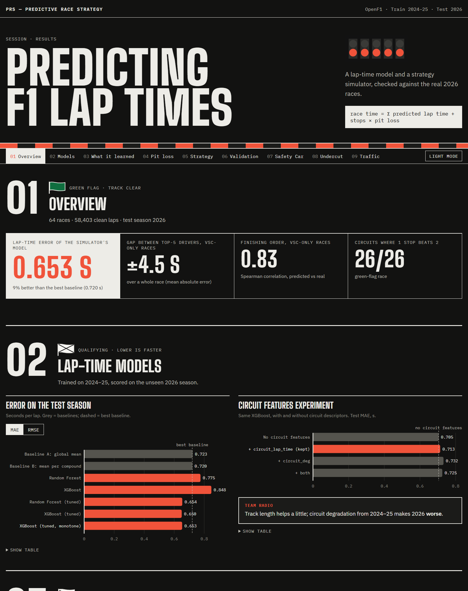
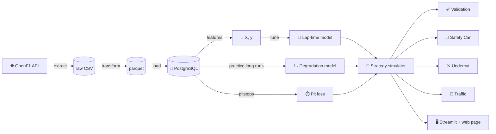

<div align="center">

# 🏎️ Predictive Race Strategy

**Predict Formula 1 lap times with machine learning, then simulate pit-stop windows to find the fastest race strategy.**

[](https://www.python.org/)
[](https://pola.rs/)
[](https://xgboost.ai/)
[](https://www.postgresql.org/)
[](https://openf1.org)

**[🌐 See the results page →](https://anabbarbosa.github.io/predictive_race_strategy/)**

[](https://anabbarbosa.github.io/predictive_race_strategy/)

</div>

---

## 📖 Overview

```
Race time = Σ (predicted lap time for every lap) + (number of pit stops × pit loss)
```

1. **🧠 Machine learning**: a model (XGBoost / Random Forest) predicts how fast lap N is on compound C with tyres T laps old.
2. **🔁 Simulation**: every 1- and 2-stop strategy goes through the model, plus the pit losses, and the fastest one wins.
   Safety Cars, undercuts and traffic are simulated on top.

Trained on **2024–2025**, tested on the unseen **2026** season, with data from [OpenF1](https://openf1.org).

### Headline results

| | |
|---|---|
| Lap-time error (monotone XGBoost) | **0.653 s** MAE, 9% better than the best baseline |
| Gap between top-5 finishers, VSC-only 2026 races | **±4.5 s** over a whole race, Spearman 0.83 |
| First pit stop vs 1-stop winners, re-planning at the real Safety Cars | **±3 laps** (±12 without re-planning) |
| Same number of stops as the 2026 winner | 7/14 races |

---

## 🏗️ Architecture



**ETL.** Every race and practice session of 2024–2026 from OpenF1 (laps, stints, pits, weather, race control). Polars
joins laps to stints and weather, computes tyre life, flags in/out-laps and SC/VSC laps, and removes lap 1, pit laps,
neutralised laps, wet running and laps slower than 107% of the driver's median. It also builds the pit-stop, result,
Safety Car period and practice tables. Reloads into PostgreSQL are idempotent.

**Target.** `lap_delta` = fuel-corrected lap time (0.05 s per lap of fuel) minus the driver's median in that race. This
cancels circuit and season pace, so the model only learns what changes *within* a race. Predicting the raw lap time,
both models did worse than the mean.

**Features.** Tyre life, compound, lap number, track temperature, team, year and circuit lap time.
The split is by season, so laps of one race never end up on both sides.

---

## 🧠 Models

Test season 2026, seconds of `lap_delta`:

| Model | MAE | RMSE |
|---|---|---|
| Baseline: training mean per compound | 0.720 | 1.052 |
| Random Forest / XGBoost (defaults) | 0.775 / 0.848 | 1.182 / 1.294 |
| Random Forest (tuned) | 0.654 | 0.978 |
| XGBoost (tuned) | 0.650 | 0.976 |
| **XGBoost (tuned, monotone)**, used by the simulator | **0.653** | **0.979** |

Untuned, both models overfit and lose to the baseline. Tuning uses `GroupKFold` by race and picks shallow, regularised
trees. The monotone constraint makes predicted lap time rise with tyre life, at no cost in accuracy.

- **SHAP**: tyre life moves a lap by 0.26 s on average, the compound by **0.007 s**. The three compounds follow the
  same degradation curve, which flattens after ~25 laps where data runs out.
- **Circuit features**: per-circuit degradation from 2024–25 makes 2026 worse (0.705 → 0.732 MAE). Track length makes
  no clear difference.


---

## 🔁 Strategy and validation

**Pit loss** is measured as in-lap + out-lap − 2 normal laps: median **22.5 s**, from ~20 s (Miami, Spa) to ~28 s
(Lusail, Imola).

**Strategy search.** Every 1- and 2-stop strategy with two dry compounds, stints of 5 laps up to the p99 tyre life seen in
training. ~20,000 strategies per race in one `predict` call. One stop wins at all 26 circuits. Shanghai, Mercedes:
**MEDIUM 33 → HARD 23**, with every pit lap from 21 to 42 within 1 s.

**Validation** against the top 5 of every 2026 race on their real strategies:

| Race type | Races | Race time MAE | Gap MAE | Spearman |
|---|---|---|---|---|
| **VSC only** | 6 | 70 s (1.3%) | **4.5 s** | **0.83** |
| Safety Car | 6 | 256 s (4.8%) | 8.9 s | 0.68 |
| Wet | 2 | 234 s (4.1%) | 7.5 s | 0.80 |
| Suspended | 3 | 2,156 s (29%) | 18.5 s | 0.70 |

Race time is always too fast, because neutralised laps are missing. The gap between drivers cancels that out and stays small.

---

## 🚨 Safety Car: re-planning the race

`--safety-car` runs the best strategies through 1,000 random races. Safety Cars and VSCs are drawn from the circuit's
history, shrunk towards the all-circuit average. A stop under SC costs **14.3 s (62%)** and under VSC **13.6 s (60%)**,
both measured from the data.

When a neutralisation comes out, the car **re-plans the rest of the race**: 0 to 2 more stops on any compound, with the
cheap stop available while it lasts. A stint cost table (cumulative sums over the compound × tyre life × lap grid) makes
each re-plan one vectorised lookup.

**Raced through the real 2026 Safety Cars** (plan picked with pre-2026 history only, re-planned at each real SC or VSC):

| Race | SC / VSC | Winner pitted | Plan | Raced |
|---|---|---|---|---|
| Madring | VSC 14–15 | lap 14 | lap 30 | **lap 14** |
| Shanghai | SC 10–13 | lap 10 | lap 34 | **lap 12** |
| Montreal | VSC 31–32 | lap 30 | lap 47 | **lap 31** |
| Suzuka | SC 22–27 | lap 22 | lap 30 | lap 26 |
| Miami | SC 6–11 | lap 26 | lap 33 | lap 10 |
| Singapore | VSC 8–9 | lap 32 | lap 38 | lap 8 |

Re-planning brings the first stop from ±12 to **±3 laps** of the winner's. Miami and Singapore pit at an early
neutralisation that the winners ignored: with the model's flat degradation, a 45-lap stint looks free.

---

## 📉 Degradation model from practice long runs

An experiment to fix the model's flat, compound-blind degradation (`--degradation 1`, `--lap-model degradation`):

```
lap_delta = offset[compound] + deg[weekend, compound] × tyre_life + curvature[compound] × tyre_life² + track evolution
```

- **Practice long runs** (≥ 8 laps in FP1–3) predict that weekend's race degradation with correlation **0.44**.
  The same circuit's race one year earlier only reaches 0.14.
- It gets the stop count right in **3/4** VSC-only races (XGBoost: 2/4), e.g. 2 stops at Spielberg like the winner.
- But it misjudges weekends without long runs on a compound (Madring), and gap MAE worsens from 4.5 to 6.1 s.
  The simulator keeps XGBoost by default.

---

## ⚔️ Undercut and 🚗 traffic

- **Undercut** (`--undercut`): at Shanghai, MEDIUM → HARD, pitting one lap earlier gains **0.54 s**. The overcut never
  pays: the model has no cold out-laps.
- **Traffic** (`--traffic`): dirty air is measured from the model's residuals. It costs **0.41 s/lap** within 0.5 s of
  the car ahead and 0.17 s at 0.5–1 s. Racing the real Shanghai 2026 field, the green-flag optimum loses **9.9 s** in
  25 laps of traffic and the real strategy beats it by 6 s.

---

## 🚀 Getting started

```bash
git clone https://github.com/anabbarbosa/predictive_race_strategy.git
cd predictive_race_strategy
python -m venv .venv && source .venv/bin/activate   # Windows: .venv\Scripts\Activate.ps1
pip install -r docker/requirements.txt
```

Copy `.env.example` to `.env` with your PostgreSQL credentials, then run `python etl/db_setup.py`.

```bash
# Data: download, build the tables, load into PostgreSQL
python main.py --download 1 --download-practice 1 --process 1 --merge 1

# Models: tune and save (required before simulating), fit the degradation model
python main.py --tune 1 --degradation 1

# Strategy for a team at a circuit, or one strategy
python main.py --simulate 1 --circuit Shanghai --team Mercedes
python main.py --simulate 1 --circuit Shanghai --team Mercedes --strategy MEDIUM:10,HARD:46

# Validation against 2026, Safety Car, undercut, traffic
python main.py --validate 1
python main.py --safety-car 1 --circuit Shanghai --team Mercedes
python main.py --undercut 1 --circuit Shanghai --team Mercedes
python main.py --traffic 1 --circuit Shanghai --team Mercedes

# Results page data (web/data.js) and the Streamlit app
python main.py --web 1
streamlit run app.py
```

Other flags: `--pitstops`, `--shap`, `--plot`, `--lap-model xgboost|degradation`, `--total-laps`, `--track-temp`,
`--pit-loss`, `--test-year`. See `python main.py --help`.

> **Windows tip:** if printing tables raises `UnicodeEncodeError`, run `$env:PYTHONIOENCODING="utf-8"` first.

---

## 📁 Project structure

```
predictive_race_strategy/
├── main.py            # CLI, one flag per step
├── app.py             # Streamlit app
├── web/               # static results page (index.html, app.js, style.css, data.js)
├── etl/controller.py  # extract, transform, load
├── ml/
│   ├── features.py    # target, features, practice long runs, season split
│   ├── tuning.py      # grouped-CV tuning, monotone XGBoost
│   ├── degradation.py # degradation model from practice long runs
│   ├── simulate.py    # race simulator and strategy search
│   ├── validate.py    # validation against 2026, Safety Car replay
│   ├── safety_car.py  # Safety Car Monte Carlo with re-planning
│   ├── undercut.py · traffic.py · pit_loss.py · explain.py · export_web.py
├── plots/             # all figures
└── results/           # validation tables (CSV)
```

---

## ⚠️ Limitations

- **Compounds look alike** to the tree models, and degradation goes flat past ~25 laps of tyre life, so one stop always
  wins on a green-flag race.
- **Extra stops under Safety Car are rare** in the simulation, because a 14 s stop seldom pays mid-stint. The winners'
  late tyre changes (Silverstone, Spa, Monaco) come from track position, restarts or red flags, which are not modelled.
- **Safety Cars and traffic are separate simulations**, and rivals don't react to our car.
- **New tyres only, dry races only, fixed green-flag pit loss per circuit.**

---

## 🛠️ Tech stack

**Python** · **Polars** · **PyArrow** · **scikit-learn** · **XGBoost** · **SHAP** · **SciPy** · **SQLAlchemy** · **psycopg** · **PostgreSQL** · **Click** · **Matplotlib** · **Streamlit**

---

## 🙏 Acknowledgements

- [OpenF1](https://openf1.org) for the free and open Formula 1 data API.
